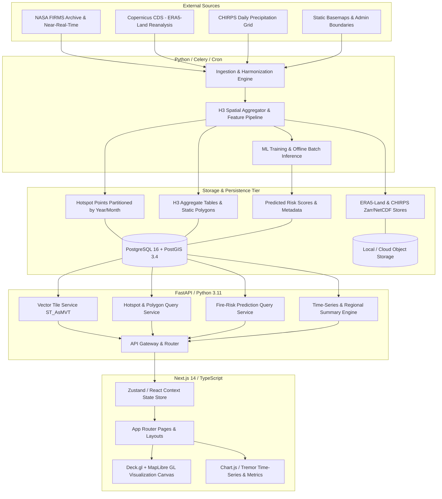

# System Architecture Specification — KARSA-FIRE

> **Document Version:** 1.0.0-draft  
> **Status:** Proposal Under Review (Phase 0)  
> **Author:** Senior Software Architect & Geospatial Data Lead

---

## 1. Architectural Philosophy & Design Principles

KARSA-FIRE is designed around five core architectural pillars:
1. **Decoupled Data, Analytical, and Presentation Planes:** Heavy geospatial vector processing and model inference must never choke interactive map rendering or blocking web requests.
2. **Standardized Spatial Binning (Discrete Global Grid System):** Raw point observations from irregular satellite orbits are projected onto Uber H3 hexagonal cells to enable uniform time-series aggregation, multi-scale neighborhood analysis, and structured ML tabular features.
3. **Progressive Spatial Delivery:** Avoid sending massive raw point datasets over HTTP. Utilize viewport bounding-box queries, vector tiles (MVT/PBF), and clustered aggregations to maintain sub-second client performance.
4. **Reproducible ML & Strict Leakage Guardrails:** Feature engineering, historical lookbacks, and model inference operate under strict temporal guards (no future data leakage) and spatial blocking.
5. **Zero-Trust Security & Observability:** All bounding box, date-range, and filter queries are strictly validated and parameterized; health metrics and logs are exposed across all services.

---

## 2. System Component Topology

---

## 3. Component Responsibilities

### 3.1 Client Application (`web`)
- **Technology:** Next.js 14 (App Router, React 18/19, TypeScript), Vanilla CSS / Tailwind UI design tokens.
- **Responsibilities:**
  - Render dynamic geospatial interfaces (viewport pan, zoom, pitch, bearing).
  - Manage application filter state: active temporal range, confidence threshold, sensor selection (MODIS vs. VIIRS), administrative filter, and active layer toggles (Hotspots, H3 Density, Predicted Risk Heatmap).
  - Execute client-side layer blending, tooltip hover detection, and cell inspection drawers.
  - Present time-series trends and regional ranking statistics.

### 3.2 Geospatial Map Engine (`web/components/map`)
- **Technology:** MapLibre GL + Deck.gl (`@deck.gl/react`, `@deck.gl/layers`, `@deck.gl/geo-layers`).
- **Responsibilities:**
  - High-performance WebGL2 instanced rendering of thermal anomaly points.
  - Dynamic H3 hexagonal layer rendering (`H3HexagonLayer`) with color interpolation mapped to FRP or Risk Score.
  - Dynamic basemap switching (Dark Matter, Satellite Orthophoto, Minimalist Carto).

### 3.3 Backend API Service (`backend`)
- **Technology:** FastAPI (Python 3.11+), Pydantic v2, asyncpg / SQLAlchemy 2.0 (async), GeoAlchemy2.
- **Responsibilities:**
  - Validate and sanitize query parameters (`bbox`, `start_date`, `end_date`, `confidence`, `admin_id`).
  - Serve dynamically generated Mapbox Vector Tiles (`ST_AsMVT`) for multi-scale vector rendering.
  - Serve GeoJSON feature collections for regional administrative boundary overlays.
  - Expose summary analytical endpoints (daily counts, monthly trends, regional risk rankings).
  - Authenticate administrative requests and rate-limit public clients.

### 3.4 Spatial Database Tier (`db`)
- **Technology:** PostgreSQL 16 + PostGIS 3.4 + `h3-pg` extension.
- **Responsibilities:**
  - Store raw point events with spatial indexing (`GIST(geom)`) and temporal indexing (`BRIN(acq_date)`).
  - Table partitioning by acquisition year/month (`hotspots_y2023m08`, etc.) for query pruning.
  - Pre-aggregate H3 grid cells at daily and monthly intervals to prevent on-the-fly table scans over millions of records.

### 3.5 Data & ML Pipeline Service (`pipelines`)
- **Technology:** Python 3.11+, Pandas, GeoPandas, Xarray, Zarr, LightGBM / Scikit-Learn.
- **Responsibilities:**
  - Download, decompress, and harmonize NASA FIRMS active fire feeds.
  - Ingest gridded climate reanalysis (ERA5-Land: 2m temperature, relative humidity, 10m u/v wind, volumetric soil moisture layers) and CHIRPS precipitation.
  - Generate spatial-temporal training matrices indexed by `(h3_index, date)`.
  - Train calibrated predictive models using Blocked Spatio-Temporal Cross Validation.
  - Batch-generate daily forward risk scores into `fire_risk_predictions`.

---

## 4. Trade-off Analysis & Architectural Decisions

| Decision Topic | Selected Option | Considered Alternatives | Justification & Trade-off Analysis |
|---|---|---|---|
| **Frontend Framework** | Next.js 14 (App Router) | Vite SPA, Remix | Next.js provides robust server-side rendering for landing/analytical reports, optimized bundle splitting, and modern developer tooling. Trade-off: Slightly higher deployment complexity than a static Vite SPA. |
| **Map Rendering Engine** | Deck.gl + MapLibre GL | Leaflet, OpenLayers, Mapbox GL JS | Leaflet degrades rapidly when rendering >5,000 DOM/SVG point nodes. Deck.gl uses GPU buffers (WebGL2), easily animating 100,000+ points at 60 FPS. MapLibre GL provides open-source, non-metered vector basemap rendering. |
| **Spatial Indexing Strategy** | Uber H3 (Hexagonal DGGS) | Regular Rectangular Grid, Geohash, S2 Geometry | Hexagons have equidistant neighbors (all 6 neighbors share identical center-to-center distances), minimizing boundary quantization artifacts. Geohash has severe boundary distortion near equator/poles. |
| **Backend Framework** | FastAPI (Python) | Node.js (Express/Nest), Go (Gin) | Python is the undisputed lingua franca for geospatial libraries (GeoPandas, Shapely, PyProj, Xarray, GDAL) and ML toolchains (PyTorch, LightGBM). FastAPI offers async ASGI performance matching Node.js with native Pydantic validation. |
| **Vector Delivery** | PostGIS MVT + GeoJSON REST | Static GeoJSON files, FlatGeobuf | GeoJSON files scale poorly over large bounding boxes. PostGIS `ST_AsMVT` generates compressed binary protocol buffers clipped to tile extents, reducing network payloads by up to 85%. |

---

## 5. Security, Resilience & Scalability Considerations

1. **Spatial Denial of Service (Geo-DoS) Protection:**
   - Spatial queries specifying unbounded bounding boxes can lock database worker threads.
   - Guardrail: Maximum allowable bounding box area enforced at API gateway level; zoom-dependent data culling (if zoomed out, enforce pre-aggregated H3 cells rather than individual point events).
2. **Database Partitioning & Indexing:**
   - FIRMS historical records over 10+ years across Southeast Asia exceed several million rows.
   - Declarative range partitioning on `acq_date` combined with composite indexes `(acq_date, h3_res7)` ensures predictable $O(\log N)$ query latency.
3. **Environment Isolation & Secrets Management:**
   - Database credentials, NASA FIRMS MAP_KEY tokens, and cloud keys are injected exclusively via environment variables. Zero credentials committed to version control.
