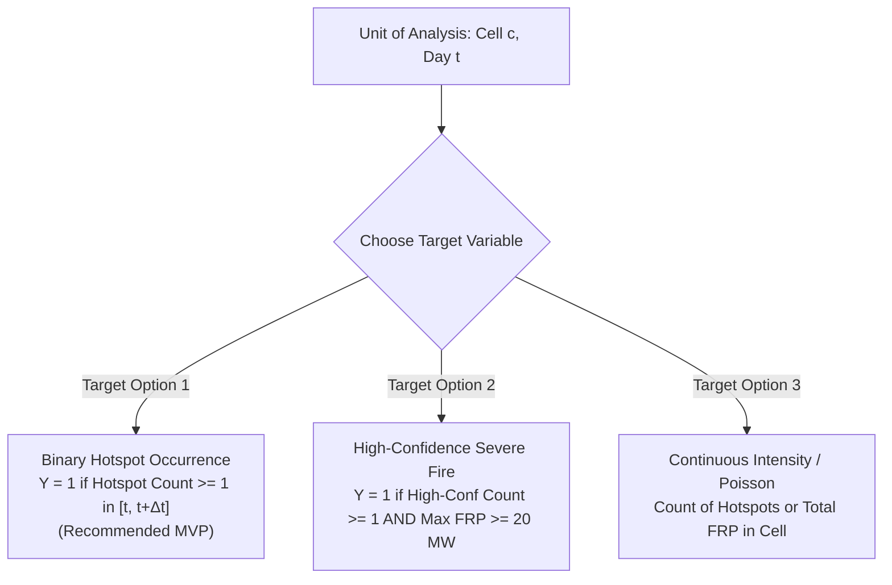

# Machine Learning Specification (ML-SPEC) — KARSA-FIRE

> **Document Version:** 1.0.0-draft  
> **Status:** Methodological Framework (Phase 0 — Pre-Modeling)  
> **Mandatory Rule:** No model training or algorithm finalization shall occur until the prediction target, label definition, spatial unit, and validation splits are formally approved by the project lead.

---

## 1. Problem Formulation & Candidate Prediction Targets

Predicting wildfire occurrence is a high-dimensional, highly imbalanced spatio-temporal classification and risk estimation task.

### 1.1 Spatial & Temporal Granularity
- **Spatial Unit ($c$):** Uber H3 hexagonal grid cell.
  - *Candidate Resolution 7:* Area $\approx 5.16\text{ km}^2$, edge $\approx 1.22\text{ km}$. (Recommended for regional macro-forecasting).
  - *Candidate Resolution 8:* Area $\approx 0.74\text{ km}^2$, edge $\approx 461\text{ m}$. (High-fidelity, requires greater compute/memory).
- **Temporal Step ($t$):** Daily observation time step (UTC 00:00 to 23:59).
- **Forecast Horizon ($\Delta t$):**
  - **Horizon 1 ($24\text{ hours}$):** Next-day tactical fire hazard alert.
  - **Horizon 2 ($72\text{ hours}$):** Medium-term logistics and equipment prepositioning.
  - **Horizon 3 ($7\text{ days}$):** Strategic regional readiness.

---

### 1.2 Candidate Target Formulations



#### Target Formulation Option 1: Binary Active Fire Occurrence (Recommended for MVP)
$$Y_{c, t, \Delta t} = \begin{cases} 1 & \text{if } \sum_{\tau=t+1}^{t+\Delta t} \text{Hotspots}_{\text{nominal/high}}(c, \tau) \ge 1 \\ 0 & \text{otherwise} \end{cases}$$
- **Pros:** Well-conditioned probabilistic classification; directly translates to probability of fire occurrence $P(Y=1 \mid \mathbf{X})$.
- **Cons:** Treats a single isolated smoldering pixel identical to a multi-hectare firestorm unless weighted.

#### Target Formulation Option 2: Severe Fire Radiative Power (FRP) Exceedance
$$Y_{c, t, \Delta t} = \begin{cases} 1 & \text{if } \max_{\tau \in [t+1, t+\Delta t]} \text{FRP}(c, \tau) \ge \tau_{\text{threshold}} \\ 0 & \text{otherwise} \end{cases}$$
- **Pros:** Filters out minor agricultural slash-and-burn and focuses on destructive conflagrations.
- **Cons:** Sensitive to satellite view angle and cloud obstruction of peak radiance.

---

## 3. Spatio-Temporal Validation Strategy (Zero-Leakage Guarantee)

Wildfire and weather data exhibit severe spatial autocorrelation (nearby cells share identical weather) and temporal autocorrelation (today's weather resembles yesterday's). Standard random K-fold cross-validation results in catastrophic data leakage and wildly over-optimistic performance metrics.

### 3.1 Validation Rules & Splitting Protocol

```text
Temporal Axis (Years):
[---------- Train (2018 - 2022) ----------] [== Embargo (30d) ==] [--- Val (2023) ---] [== Embargo (30d) ==] [--- Test (2024) ---]
```

1. **Temporal Blocking (Out-of-Time Testing):**
   - **Training Set:** Historical seasons (e.g., 2018-01-01 to 2022-12-31).
   - **Validation Set (Hyperparameter Tuning):** Subsequent dry/wet cycle (e.g., 2023-01-01 to 2023-12-31).
   - **Holdout Test Set (Final Benchmarking):** Unseen recent year (e.g., 2024-01-01 to 2024-12-31).
2. **Spatial Blocking (Out-of-Region Validation):**
   - For spatial generalization, implement **Spatial Block K-Fold** (partitioning by disjoint administrative provinces or geographic quadrangles buffered by $\ge 50\text{ km}$).
3. **Temporal Embargo:**
   - Enforce an embargo period of at least 7 days between training and evaluation slices to prevent short-term weather persistence leakage.

---

## 4. Feature Space & Covariate Dictionary

| Feature Category | Feature Name | Description & Calculation |
|---|---|---|
| **Meteorological (ERA5-Land)** | `t2m_max_7d` | Maximum 2-meter air temperature over rolling 7-day lookback. |
| | `rh_min_7d` | Minimum relative humidity derived from $T$ and $T_d$ over rolling 7 days. |
| | `vpd_mean` | Vapor Pressure Deficit (atmospheric drying demand). |
| | `wind_speed_mean` | Derived vector magnitude: $\sqrt{u10^2 + v10^2}$. |
| **Hydrological (ERA5 & CHIRPS)** | `soil_moisture_swvl1` | Volumetric soil moisture in top $0-7\text{ cm}$ layer. |
| | `soil_moisture_swvl2` | Volumetric soil moisture in root/peat layer $7-28\text{ cm}$. |
| | `consecutive_dry_days` | Number of days since daily rainfall was $\ge 1.0\text{ mm}$ (from CHIRPS). |
| | `precip_accum_30d` | Cumulative precipitation over previous 30 days. |
| **Landscape & Land Cover** | `is_peatland` | Binary mask indicating presence of tropical peat soils. |
| | `land_cover_class` | Categorical land cover (primary forest, degraded forest, oil palm plantation, shrubland). |
| | `elevation`, `slope` | Topographic variables from SRTM / Copernicus DEM. |
| **Autoregressive / Spatial Lag** | `hotspots_k1_3d` | Count of hotspots detected in the immediate 1-ring H3 neighborhood over the past 3 days. |
| | `hotspots_cell_7d` | Count of hotspots detected in the target cell over the past 7 days. |

> [!CAUTION]
> **Strict Guard Against Future Leakage:**  
> All autoregressive and meteorological features for target date $t+\Delta t$ must be computed strictly using data available up to time $t$. Forecast weather features must use actual numerical weather prediction forecasts (e.g., GFS/ECMWF), not future reanalysis.

---

## 5. Candidate Model Architectures & Baselines

### 5.1 Mandatory Baseline Heuristics
Before evaluating complex ML algorithms, two baseline models must be benchmarked:
1. **Persistence Heuristic:** Predicts fire in cell $c$ at $t+\Delta t$ if a hotspot was observed in cell $c$ or any 1-ring neighbor in the preceding 48 hours.
2. **Simple Fire Weather Index (FWI) Heuristic:** Classifies fire risk based purely on a calibrated threshold of consecutive dry days and relative humidity.

### 5.2 Supervised Learning Candidates
- **Primary Candidate:** **LightGBM / XGBoost** (Gradient Boosted Decision Trees).
  - *Rationale:* Superior tabular performance, native handling of missing values, fast GPU/CPU training, robust feature importance via TreeSHAP.
- **Secondary Candidate (Phase 2+):** Spatio-Temporal Graph Neural Networks (ST-GNN) or ConvLSTM for spatial propagation dynamics.

---

## 6. Evaluation Metrics & Calibration

Given severe class imbalance (wildfire occurrences typically comprise $<0.5\%$ of space-time grid cells):
- **Primary Metric:** **PR-AUC (Precision-Recall Area Under Curve / Average Precision)**. ROC-AUC is misleadingly high on extreme imbalance.
- **Decision Utility Metric:** Precision, Recall, and $F_1$ evaluated at fixed operational alert thresholds (e.g., top 1%, 5% highest risk cells).
- **Calibration Quality:** **Brier Score** and Expected Calibration Error (ECE). A predicted 0.80 risk must correspond to approximately 80 historical fire occurrences out of 100 such predictions.
