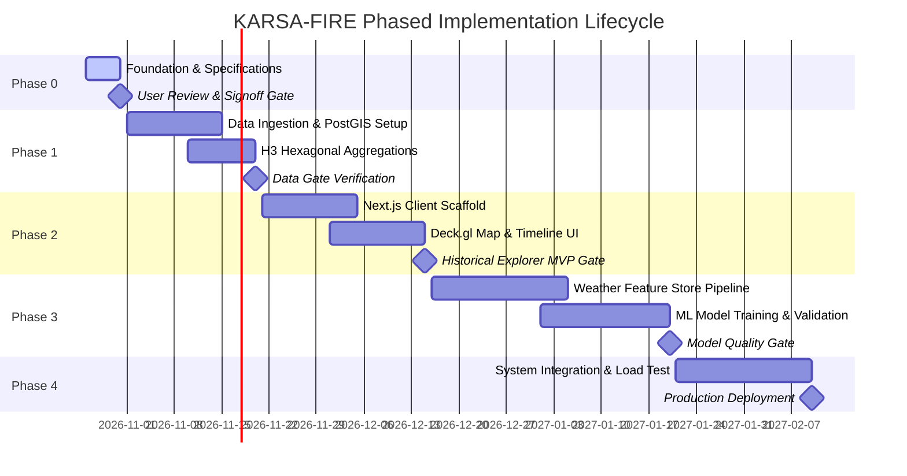

# Engineering Roadmap — KARSA-FIRE

> **Document Version:** 1.0.0-draft  
> **Status:** Active Roadmap  
> **Current Phase:** Phase 0 (Foundation Only)

---

## Roadmap Overview & Phase Gates

---

## Phase 0: Technical Foundation & Architecture Governance (CURRENT)

### Objectives
- Establish complete project specifications, data dictionaries, API contracts, ML validation protocols, and user experience requirements.
- Inspect workspace and verify non-destructive baseline.
- Establish architectural decision records (ADRs) and define facts vs. assumptions.

### Entry Criteria
- Project kickoff request received.

### Exit Criteria & Phase 0 Deliverables
- [x] Workspace inspected (verified clean repository on `main` branch).
- [x] `AGENTS.md` operating laws and skills established.
- [x] `README.md` and project index established.
- [x] `docs/PRD.md` drafted and aligned with MVP boundaries.
- [x] `docs/ARCHITECTURE.md` completed with trade-off analyses.
- [x] `docs/DATA_DICTIONARY.md` completed for FIRMS, ERA5, CHIRPS, and PostGIS schemas.
- [x] `docs/API_SPEC.md` drafted with OpenAPI schemas.
- [x] `docs/ML_SPEC.md` drafted with zero-leakage validation protocols.
- [x] `docs/UX_SPEC.md` drafted with accessible colorblind scales and layout diagrams.
- [x] `docs/DECISIONS.md` initialized with ADRs 001–007.
- [x] `docs/PROJECT_STATE.md` and `CHANGELOG.md` created.
- [ ] User review and formal signoff on Phase 0 direction.

---

## Phase 1: Data Ingestion & Spatial Storage Pipeline

### Objectives
- Set up local/containerized PostgreSQL 16 + PostGIS 3.4 database.
- Develop Python ingestion scripts for NASA FIRMS (VIIRS & MODIS) historical archives for the approved pilot study area.
- Implement H3 hexagonal index generation (Resolution 7 and 8) on ingested points.
- Create partitioned tables and automated spatial views.

### Exit Criteria
- Reproducible Docker Compose environment running PostgreSQL/PostGIS.
- Successfully ingested pilot hotspot dataset (e.g., 2019–2024 for pilot province) with verified coordinate fidelity.
- Pre-aggregated daily H3 table generated and queried in $<50\text{ ms}$.

---

## Phase 2: Historical Hotspot Web Application (MVP)

### Objectives
- Scaffold Next.js 14 (App Router, TypeScript) web application.
- Implement Deck.gl + MapLibre GL map container rendering base tiles and hotspot vector overlays.
- Build the interactive timeline scrubber with daily FRP histogram.
- Build filter controls (Sensor, Confidence, Date Range, Administrative Region).
- Implement Cell Inspection Drawer showing historical events.

### Exit Criteria
- Seamless rendering of 50,000+ points at 60 FPS in WebGL2.
- Fully functional temporal scrubbing and filtering.
- Automated Cypress / Playwright E2E smoke tests passing.

---

## Phase 3: Machine Learning & Predictive Risk Pipeline

### Objectives
- Build feature extraction pipeline pulling ERA5-Land weather covariates and CHIRPS precipitation.
- Construct spatial-temporal dataset matrix indexed by `(h3_index, date)`.
- Benchmark Baseline Heuristic Models (Persistence & Simple FWI).
- Train LightGBM gradient boosted model using Blocked Spatio-Temporal Cross Validation.
- Evaluate PR-AUC, Brier calibration scores, and SHAP feature importances.
- Implement batch daily inference job writing forward risk scores to PostGIS.

### Exit Criteria
- Model outperforms both baseline heuristics on out-of-time test sets (e.g., 2024 holdout).
- Brier calibration curve demonstrates reliable risk probabilities.
- Feature leakage audits pass 100%.

---

## Phase 4: Operationalization, Security & Production Hardening

### Objectives
- Integrate predictive risk layer into Next.js client interface with explainability drawer.
- Implement vector tile serving (`ST_AsMVT`) for scalable low-latency delivery.
- Conduct security hardening (rate limiting, bounding box sanity, secret management).
- Write automated end-to-end integration test suites and CI/CD pipelines.

### Exit Criteria
- System passes automated load testing ($\ge 100$ concurrent simulated users).
- Accessibility audit achieves WCAG 2.1 AA compliance.
- Complete operational runbook and deployment guides delivered.
